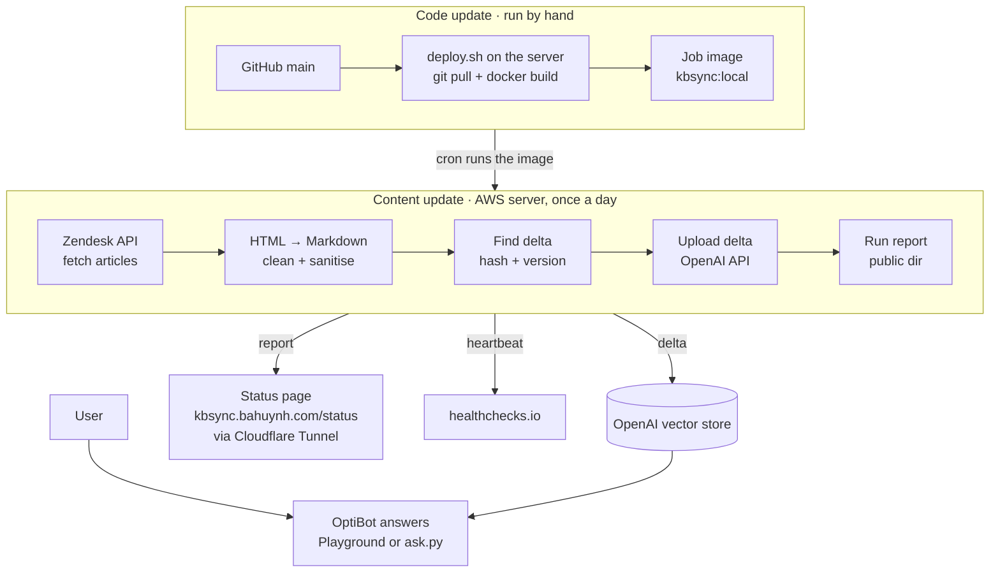

# kb-sync-lab

Live status: https://kbsync.bahuynh.com/status/

A daily job pulls help-center articles from support.optisigns.com, converts them to clean Markdown and uploads only what changed to an OpenAI vector store. `ask.py` answers questions from it with cited sources.

## Setup
Needs Python 3.12 and `uv`. `cp .env.sample .env` (set `API_KEY`; the sample uses the dev store `optibot-kb-dev`), then `uv sync`.

## Run locally
`uv run main.py` syncs all articles (416 on 2026-10-30) and writes one Markdown file per article to `out/articles/`. `uv run ask.py "How do I add a YouTube video?"` asks the store.

## Run in Docker
`docker build -t kb-sync-lab . && docker run --rm -e API_KEY=sk-... kb-sync-lab`

It runs once and exits 0. `--env-file .env` also works.

## Chunking
Static chunks of 600 tokens with 150 overlap. Most articles are longer than one chunk, and 600/150 tied 800/400 at 9/10 on a retrieval check, so the smaller, more focused chunks stay. Logged chunk counts are estimates, because OpenAI exposes no exact count. See `docs/chunking.md`.

## Links
Links to other articles are rewritten to absolute support URLs. A Markdown file outside the site cannot resolve relative links, and citations must open.

## No Assistant object
OpenAI shut the Assistants API down, so the system prompt lives in `prompts/optibot.md` and `ask.py` sends it with File Search. Playground steps: `docs/playground.md`.

## Daily job
Code and content update separately. Deploying (`deploy/deploy.sh`, run by hand on the server, see `docs/runbook.md`) pulls `main` and rebuilds the image; it changes nothing in OpenAI.

Cron runs that image at 02:17 UTC. Each run re-reads every article and skips those whose update time and converter version, or content hash, still match. It uploads the rest and removes files for deleted articles; if more than 10% of the store would go, it deletes nothing. It logs `added`, `updated`, `skipped`, `deleted`, `failed`, `files` and `chunks`.

Logs: https://kbsync.bahuynh.com/runs/latest.json.

## Screenshot

## Security
Use a dedicated OpenAI project with a spend limit and delete the vector store afterwards. Article text is untrusted: sanitising reduces the risk of prompt injection and does not remove it.

## Tests
`uv run pytest -q`. `make demo` walks the whole flow against the dev store.
