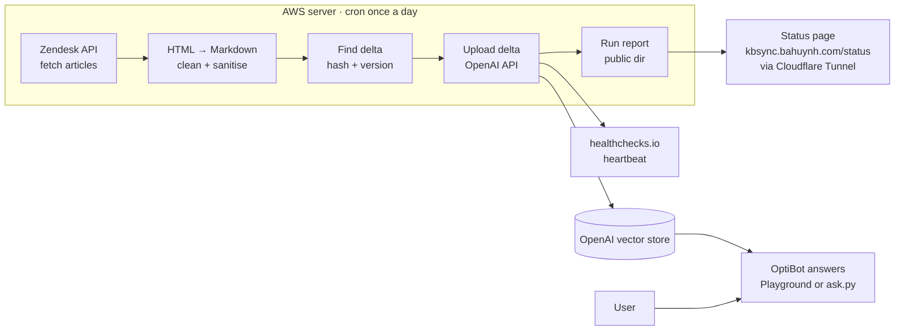
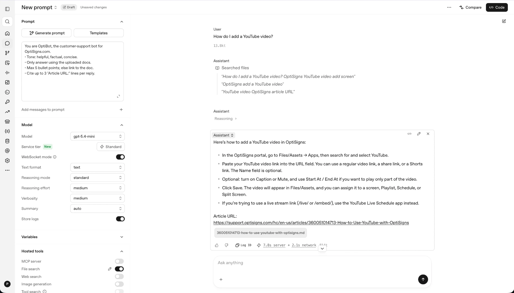

# kb-sync-lab

A daily job pulls help-center articles from support.optisigns.com, converts them to clean Markdown and uploads only what changed to an OpenAI vector store. `ask.py` answers questions from it with cited sources.

## Setup
`cp .env.sample .env` (set `API_KEY`), then `uv sync`.

## Run locally
`uv run main.py` syncs the store; `uv run ask.py "How do I add a YouTube video?"` asks it.

## Run in Docker
`docker build -t kb-sync-lab . && docker run --rm -e API_KEY=sk-... kb-sync-lab`

## Chunking
Static chunks of 600 tokens with 150 overlap. Most articles are longer than one chunk, and 600/150 tied 800/400 at 9/10 on a retrieval check, so the smaller, more focused chunks stay. See `docs/chunking.md`.

## Links
Links to other articles are rewritten to absolute support URLs. A Markdown file outside the site cannot resolve relative links, and citations must open.

## No Assistant object
OpenAI shut the Assistants API down, so the system prompt lives in `prompts/optibot.md` and `ask.py` sends it with File Search. Playground steps: `docs/playground.md`.

## Daily job
Cron on the server runs it once a day (deploy: `docs/runbook.md`). Logs: https://kbsync.bahuynh.com/runs/latest.json.

## Screenshot

## Security
Use a dedicated OpenAI project with a spend limit and delete the vector store afterwards. Article text is untrusted: sanitising reduces the risk of prompt injection and does not remove it.

## Tests
`uv run pytest -q`. `make demo` walks the whole flow against the dev store.
